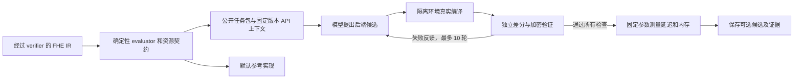

# AI 辅助后端：设计与已实现的离线入口

## 分工

开题报告答辩意见要求 AI 限定在后端辅助，FHE 算法映射和专用 pass 由编译器完成。现有确定性 `crossfhe-translate` 已能生成 SEAL/OpenFHE evaluator，因此 AI 的第一阶段任务应为**在固定 FHE 算法、参数和接口下提出库适配或调度候选**，不需要替代已验证的编译器。



## 已实现：公开任务准备器

```bash
source /root/miniconda3/etc/profile.d/conda.sh
conda activate CompilerforFHE
export PYTHONPATH="$PWD/front${PYTHONPATH:+:$PYTHONPATH}"
python -m crossfhe demo affine --backend seal-ckks --output artifacts/ai-reference
python scripts/prepare_ai_backend.py artifacts/ai-reference --output artifacts/ai-task
```

准备器要求编译状态为 ready，并检查公开 context 的 SHA-256 以及 manifest/native contract 一致性。白名单导出：

| 文件 | 用途 |
| --- | --- |
| `task.json` | backend、库 revision、ABI 约束、资源契约、最多 10 轮修复、context hash、未验证状态 |
| `contract.json` | 由原生 MLIR 工具得到的深度、方案转换次数和原语数量 |
| `program.mlir` | 已优化的 FHE 计算图 |
| `reference.hpp` | 确定性生成的 evaluator，供差分验证 |
| `seal_runtime.hpp` 或 `openfhe_runtime.hpp` | 当前实际实现的 API 与语义 |
| `PROMPT.md` | 候选输出要求与不可修改的条件 |

它不递归复制 artifact，不导出客户端明文、secret keys、密文或 runner 二进制，不修改可执行 artifact，不请求模型 API，也不编译/运行候选。输出状态恒为 `prepared_unvalidated`，`validation_performed=false`，`promotion_allowed=false`。非空输出目录和被改动的 context 会报错。

已有 4 项任务准备测试覆盖公开导出、hash 篡改拒绝、artifact 覆盖拒绝及非空输出目录保护，并已对真实编译 artifact 运行过准备命令。

## 下一阶段如何实现在线生成

1. **任务契约**：由编译器输出 typed DAG、输入输出 tensor mapping、参数计划、局部近似约定、目标库 revision 和目标硬件。模型无权重新决定明文/秘密划分、跨方案编码或降低安全参数。
2. **版本化检索**：从本机固定 revision 的头文件、真实例程和 runtime adapter 建立 API 文档索引，先用符号/签名检索；需要时再添加 embedding。检索条目保存路径、revision、内容 hash，避免模型混用不同库版本。无需把密钥或客户输入发送给模型。
3. **受限候选表示**：第一版让模型返回调度顺序、复用/释放位置、合法 API 绑定等结构化 JSON，编译器检查依赖和参数后生成 C++。后续开放 `candidate.hpp` 时，应按不可信源码处理，使用独立的构建和执行隔离，不能直接挂载客户端密钥目录执行。
4. **实际构建**：复用项目 CMake/backend 环境，记录编译器命令、stderr、退出码、超时及库 revision。只有 exit code 0 且目标二进制存在才算编译通过。
5. **独立数值校验**：冻结参考 evaluator；测试零、正负、边界、混合数量级和固定 seed 的随机输入。可信客户端完成 keygen/encrypt/decrypt，候选只接收 evaluator 所需公开/评估键与密文。分别比较候选与参考、候选与明文；显式记录绝对/相对误差、方案转换计数和 artifact hash。TOY 功能结果不能替代固定安全参数验证。
6. **修复反馈**：状态机为 prepared → generated → build_passed → functional_passed → policy_passed → measured → selectable。每次失败只反馈可复现的编译/执行诊断、公开用例描述和指标，保存 candidate hash 与原始响应。最多 10 轮；超限、验证器异常或证据不足，保留参考实现。
7. **安全约束检查**：由外部可信配置锁定参数和 key ownership；静态 API/AST 检查作为必要检查，不作为密码学安全证明。不得把“能解密”或“源码出现 Encrypt”判断为安全。侧信道、全应用安全和候选行为约束仍需单独研究，不能靠正则扫描宣称解决。
8. **公平测量**：候选与参考使用相同库、参数、精度、数据、线程数和硬件；先证明目标约束内正确，再测多次延迟、峰值内存与尾部统计。不得用降低精度/安全、移除检查或选择 TOY 参数解释加速。

## 跨库和 GPU 路线

第一版只面向已有 `seal-ckks` / `openfhe-cross` CPU 接口。跨库适配必须由编译器的能力矩阵确认原语存在，例如 SEAL 不能直接承接 FHEW sign。GPU 路线需要真正的 GPU FHE 库接口、数据布局、设备内存和 stream/同步契约，再让 AI 选择已有内核及调度；不能生成一个 `cuda` 名字然后回落到明文或 CPU 并计作 GPU 成果。

在线模型调用、隔离候选执行、自动修复和候选晋升尚未实现，本轮完成的是设计和可复用的离线输入接口。
